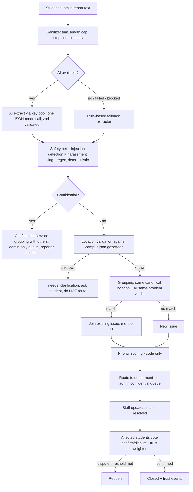

# Architecture

Single Next.js process (App Router, TypeScript). Browser talks only to Next.js. Next.js server talks to Supabase (service_role key, server only) and Gemini (key pool). No Docker, no Supabase CLI.

**Principle: AI understands text; code decides everything else.**

## Report pipeline (to be built; steps marked as stubs today)

## Layers
| Layer | Path | Responsibility |
|---|---|---|
| UI | `src/app`, `src/components` | Polished, accessible pages; no business logic (services own it) |
| Routes | `src/app/api` | zod validate -> service -> response |
| Services | `src/lib/services` | Orchestrate pipeline, voting, trust |
| Rules | `src/lib/rules` | Pure deterministic logic (priority, safety, location, voting...) |
| AI | `src/lib/ai` | Gemini wrapper + key pool + fallback; output only structured fields |
| Data | `src/lib/db` | Supabase client, repositories (the ONLY access path), schema.sql, RPCs |

## Gemini key pool (implemented)
`keyPool.ts`: keys from `GEMINI_API_KEYS` (trimmed, deduped). Round-robin. 429/RESOURCE_EXHAUSTED -> cooldown (server retry delay or 60s) and try next key immediately. 5xx/timeout/network -> exponential backoff + jitter, then next key. 401/403/"API key not valid" -> key disabled for process lifetime. Safety block -> stop immediately (fallback). Empty/invalid JSON -> failed attempt. Attempt cap = keys + 2, per-call timeout 15s. All exhausted -> `{ ok:false, mode:"fallback" }` (never throws). `getAiStatus()` returns counts only (used by the banner and `/api/ai/status`). State lives on `globalThis` so dev hot reload does not reset cooldowns.

## Confidentiality
Sensitive issues are flagged at ingestion (AI flag OR regex net; either can raise, nothing lowers). Repositories never return confidential rows through public/department queries; the admin confidential queue returns them with the reporter replaced by "Anonymous reporter". Confidential reports are never grouped with other students' reports.

## Current-user model
Cookie `reportfix_user` stores only a user id. `getCurrentUser()` looks up role/department server-side on every request. Unsigned by design (judge access requires passwordless switching).
