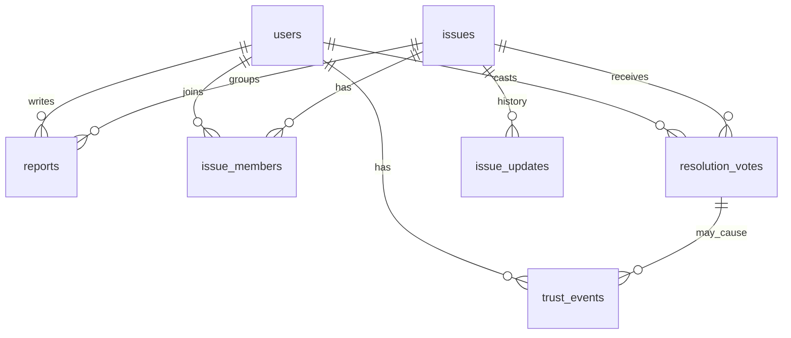

# Data model (Supabase Postgres; see `src/lib/db/schema.sql`)

All tables: RLS enabled, NO policies (public anon key reads nothing). Accessed only by the server with the service_role key.

| Table | Purpose | Key columns |
|---|---|---|
| users | Accounts | id, name, role (student/staff/admin), department, trust_score (cache), is_demo_seed |
| trust_events | Append-only ledger | user_id, delta, reason, related_report_id / issue_id / vote_id, created_at |
| reports | Raw submissions | user_id, raw_text, language, canonical_location, extracted jsonb, flags jsonb, ai_mode, is_confidential, status (received / needs_clarification / routed / grouped / rejected), issue_id |
| issues | Grouped problems | canonical_location, category, signature, department, priority, priority_score, priority_breakdown jsonb, status (open / in_progress / resolved / reopened / closed), is_confidential, me_too_count, resolution_round |
| issue_members | Affected students | issue_id, user_id, role (reporter/joined), unique(issue_id, user_id) |
| issue_updates | Status history and staff notes | issue_id, actor_id, from_status, to_status, note |
| resolution_votes | Confirm/dispute | issue_id, user_id, round, vote, weight, unique(issue_id, user_id, round) |
| audit_log | Admin/system audit | actor_id, action, entity, details jsonb |

## Trust explainability
Score = 50 + sum(trust_events.delta), clamped to 0..100. `users.trust_score` is a cache. View `user_trust_rebuilt` compares rebuilt vs cached; `rebuild_trust_scores()` repairs the cache from the ledger. Seed users get a matching "Demo seed" ledger event.

## Atomic writes (RPC)
`create_report_with_issue`, `join_issue_with_report`, `cast_resolution_vote`, `apply_trust_event` (stubs, TODO) and `reset_all_data()` (working: single TRUNCATE ... CASCADE). Only `service_role` may execute them.

## Voting rounds
`issues.resolution_round` increments each time staff mark an issue resolved; votes carry that round, so after a reopen+re-resolve students can vote again without violating the unique constraint.

## Added for phases 5-7
- `issue_members.excluded`: a member whose report was flagged no longer counts (me-too, priority, votes).
- `reports.flagged_kind / flagged_by / flagged_at / flag_note`: spam, fake or abuse flag (never on confidential reports). `reports.attention`: set when issue creation failed.
- `trust_events.kind / related_round` and a unique "once only" index per (user, kind, issue, report, round).
- Functions: `apply_trust_event`, `update_issue_status` (validates reports on first touch), `cast_resolution_vote`, `flag_report`; read helpers `issue_bundle`, `student_issues`, `member_trust_profiles`, `user_trust_profiles`. All are executable by `service_role` only.
